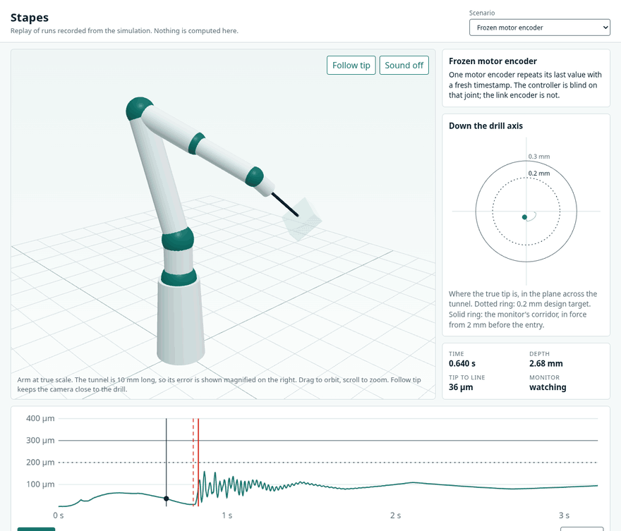
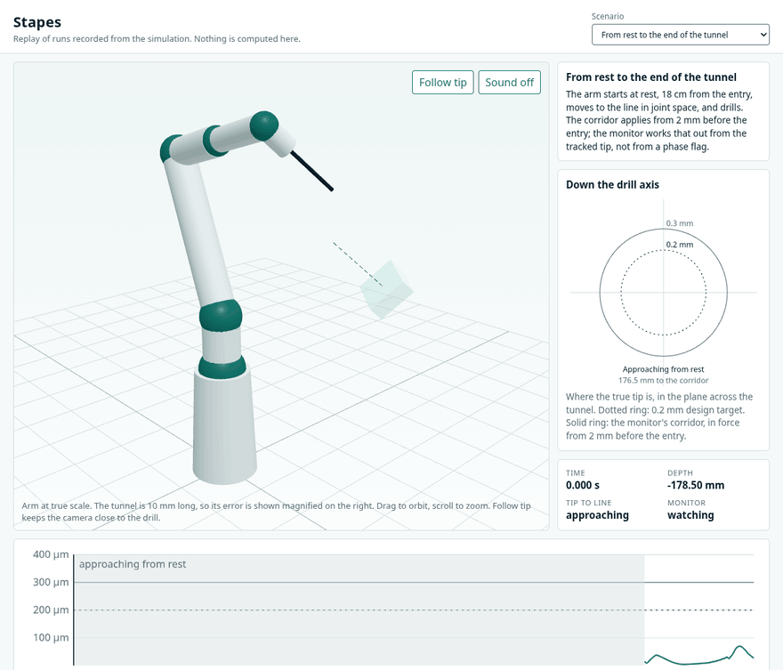
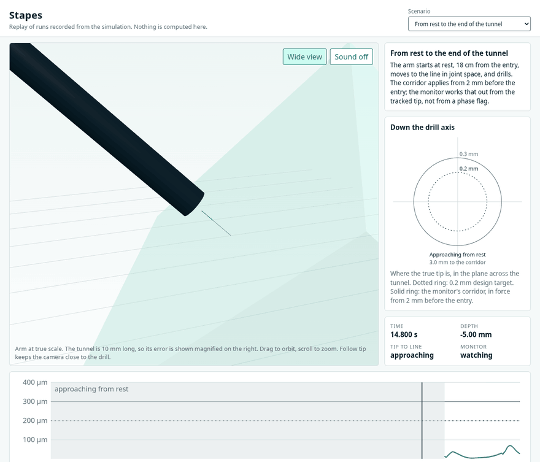
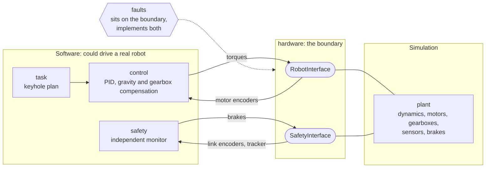
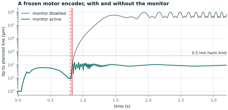
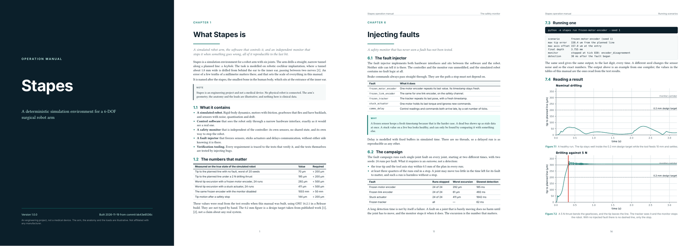

<div align="center">

# Stapes

**A deterministic simulation environment for a 6-DOF surgical robot arm, in C++20.**

A simulated robot, the software that controls it, and an independent safety monitor that stops it
when something goes wrong.

[](https://github.com/Emidsm/stapes/actions/workflows/ci.yml)
[](https://emidsm.github.io/stapes/)


**[Open the viewer](https://emidsm.github.io/stapes/)** ·
**[Read the manual (PDF)](https://emidsm.github.io/stapes/stapes-manual.pdf)** ·
[Requirements](docs/srs.md) ·
[Architecture](docs/architecture.md) ·
[Risk analysis](docs/risk-analysis.md) ·
[Decisions](docs/adr/)



<sub>A motor encoder freezes while the arm drills (dashed red line). The controller is now blind
on that joint. The monitor compares it with a second encoder and stops the robot (solid red line).
Slowed about six times.</sub>

</div>

The arm drills a straight, narrow tunnel along a planned line, a task modelled on robotic
cochlear implantation, where a few tenths of a millimetre matter. Named after the stapes, the
smallest bone in the human body, which sits at the entrance of the inner ear.

The anatomy, the loads and the arm's geometry are illustrative. This is an engineering project,
not a medical device, and no physical robot is connected.

<table>
  <tr>
    <td width="50%"></td>
    <td width="50%"></td>
  </tr>
  <tr>
    <td><sub><b>From rest.</b> The arm starts 18 cm from the entry, moves to the planned line and
    drills. About twice real time.</sub></td>
    <td><sub><b>Through the tunnel.</b> The camera follows the tool for the 10 mm feed. The
    target on the right shows the tip, magnified, inside the 0.2 mm ring. About real time.</sub></td>
  </tr>
</table>

## Contents

- [What it shows](#what-it-shows)
- [Architecture](#architecture)
- [Evidence](#evidence)
- [Built with](#built-with)
- [Operation manual](#operation-manual)
- [Build and test](#build-and-test)
- [Scenarios, plots and the viewer](#scenarios-plots-and-the-viewer)
- [Documents](#documents)
- [Limits of what is claimed](#limits-of-what-is-claimed)

## What it shows

- **A robot the controller cannot fully see.** Rigid-body dynamics, motors with friction,
  gearboxes that flex and have backlash, and encoders on the motor side, so the controller never
  sees the flex. Sensors have noise, quantisation and drift.
- **A hardware boundary.** The controller and the monitor reach the robot through two small
  interfaces. They are separate libraries that do not link the simulator, so they cannot tell it
  from a real robot, and the build fails if they try.
- **An independent safety monitor.** Its own sensors, no state shared with the controller, and
  its own way to stop. Nine checks in a fixed order, cross-checking independent sensors.
- **Fault injection.** Frozen sensors, stuck actuators and communication delay, injected between
  the software and the robot so that neither is modified.
- **An approach from rest.** The arm can start away from the patient and move to the planned
  line. The monitor holds the tip to the line from 2 mm before the entry, and works out where
  that is from the tracked tip alone, with no phase signal that the controller could get wrong.
- **Determinism.** The same seed gives a bit-identical run. A hash of the whole state is compared
  between runs, between processes, between GCC and Clang, and between C++ and Python.
- **Real-time discipline.** No heap allocation in a tick, proven by a test that counts them.

## Architecture

Everything left of the boundary is software that could run on a real robot. Everything right of
it is the simulation. The boundary is two small abstract classes, and each module is its own CMake
target, so a dependency in the wrong direction is a build error.



`plant`, `control`, `safety` and `faults` depend on `hardware` and never on each other: the
controller cannot read the simulator's true state, the monitor cannot read the controller's, and
faults need no hooks in either. [`docs/architecture.md`](docs/architecture.md) walks through one
1 ms control period, in order.

## Evidence

Every figure below is generated from test results by `tools/test_report.py`. None is typed by
hand. Accuracy is measured on the simulator's true state, which no running code can read.

<!-- evidence:begin (generated by tools/test_report.py; do not edit) -->

325 of 325 test cases pass, verifying 105 requirements.

| Measured on the true state of the simulated robot | Value | Held to |
|---|---|---|
| Tip to planned line, no fault, worst of 20 seeds | 70 um | < 200 um |
| Tip to planned line under a 2 N thrust | 195 um | < 200 um |
| Tool axis to fulcrum, remote centre of motion | 151 um | < 200 um |
| Tip to planned line after an approach from rest, worst of 4 seeds | 70 um | < 200 um |
| Fault during the approach: slowest stop, always before the entry guard | 1101 ms | recorded |
| Frozen motor encoder: worst tip excursion | 292 um | < 500 um |
| Stuck actuator: worst tip excursion | 411 um | < 500 um |
| Tip motion after a safety stop | 144 um | < 200 um |
| Frozen motor encoder with the monitor disabled: tip excursion | 1003 mm | > 50 mm (the fault is real) |

Measured with compiler gnu 16.2.1, build type release. Results are bit-exact for a given compiler and maths library, and differ slightly between them.

<!-- evidence:end -->

<p align="center">
  
</p>

<p align="center"><sub>The same frozen encoder, with the monitor (teal) and without it (grey, log
scale). Without the monitor the arm runs away from the line; with it, the tip stays under the
harm limit. Plotted by <code>python -m stapes plots</code> from recorded runs.</sub></p>

How these are checked:

| Check | What it guards against |
|---|---|
| Traceability matrix, generated from test results | A requirement with no test. CI fails if there is one. |
| Risk controls, checked by the same tool | A hazard whose control is not a verified requirement. |
| Injected bugs (`tools/mutation_check.py`) | Tests that run a line without noticing when it is wrong. |
| ASan and UBSan on everything | Memory errors and undefined behaviour. |
| GCC and Clang, warnings as errors, clang-tidy | Code that only one compiler accepts. |
| Hash comparison across compilers and processes | Hidden non-determinism. |
| A fault campaign with a baseline | Faults that pass only because they are harmless. |

Injecting bugs into the safety monitor found two that its own specification tests missed, in
code with full line coverage. [ADR 0007](docs/adr/0007-independent-safety-monitor.md) records
them.

## Built with

<p>
  
  
  
  
  
  
  
  
  
  
  
  
  
</p>

| Layer | Choice | Why |
|---|---|---|
| Core | C++20, built with GCC and Clang | Where the behaviour lives, and what is evaluated |
| Build | CMake presets, Ninja, FetchContent with pinned hashes | Reproducible, no system packages needed |
| Linear algebra | Eigen | Standard in robotics, header-only |
| Tests | GoogleTest, seeded property tests | Failures that reproduce from a seed |
| Benchmarks | Google Benchmark | The cost of a tick, as evidence |
| Scenarios and analysis | Python through pybind11, NumPy, Matplotlib, pytest | A thin layer; the core never depends on it |
| Viewer | three.js, vendored, on GitHub Pages | A link a reviewer can open; it replays and computes nothing |
| Manual | Typst, with vendored fonts and generated figures | The same PDF on every machine, with no number typed by hand |
| CI | GitHub Actions: sanitizers, clang-tidy, clang-format, coverage | Every claim checked on every push |

## Operation manual

<p align="center">
  <a href="https://emidsm.github.io/stapes/stapes-manual.pdf">
    
  </a>
</p>

How Stapes works and how to use it: the simulated robot, planning and control, the safety monitor,
fault injection, the scenarios, the viewer, and how each claim is checked. Every measured value
and figure in it is generated from the test results when it is built. CI builds it on every push
and publishes it with the viewer. Source in [`manual/`](manual/):

```sh
python tools/build_manual.py         # needs Typst and the Python layer
```

## Build and test

Requires CMake 3.28+, Ninja and a C++20 compiler. Dependencies are downloaded and checked
against pinned hashes.

```sh
cmake --workflow --preset debug      # configure, build and run the tests
cmake --workflow --preset release
cmake --workflow --preset sanitize   # with AddressSanitizer and UBSan
cmake --workflow --preset coverage   # with GCC coverage instrumentation
```

The traceability matrix and the test report:

```sh
python3 tools/traceability.py \
  --requirements docs/requirements/requirements.toml \
  --hazards docs/risk/hazards.toml \
  --results build/debug/test-results --skip-layer python \
  --output build/debug/traceability.md

python3 tools/test_report.py \
  --requirements docs/requirements/requirements.toml \
  --results build/debug/test-results --build-dir build/debug \
  --output build/debug/test-report.md
```

Injected bugs, which takes a while:

```sh
python3 tools/mutation_check.py
```

## Scenarios, plots and the viewer

The Python layer names scenarios, runs them and writes files. It adds no behaviour of its own:
everything that happens in a run happens in the C++ core.

```sh
python3 -m venv .venv && .venv/bin/pip install -r python/requirements.txt
source .venv/bin/activate
cmake --workflow --preset python     # the core, the bindings, and the tests of both

export PYTHONPATH=build/python/python:python
python -m stapes list
python -m stapes run frozen-motor-encoder
python -m stapes plots build/figures
python -m stapes export viewer/traces
python3 -m http.server 8765 -d viewer   # then open http://127.0.0.1:8765
```

The viewer replays recorded runs and computes nothing, so it cannot disagree with the tests. The
GIFs above are captured from it, one recorded tick at a time, by
[`tools/capture_viewer.mjs`](tools/capture_viewer.mjs).

## Documents

| Document | Contents |
|---|---|
| [Operation manual](https://emidsm.github.io/stapes/stapes-manual.pdf) | How it works and how to use it. Source in [`manual/`](manual/). |
| [Requirements](docs/srs.md) | What the software shall do: [`requirements.toml`](docs/requirements/requirements.toml). |
| [Architecture](docs/architecture.md) | The modules, the boundary, one control period. |
| [Risk analysis](docs/risk-analysis.md) | Hazards, the requirements that control them, residual risks. |
| [Decision records](docs/adr/) | Why each design choice was made, with measurements. |
| Traceability matrix and test report | Generated by CI on every push, as build artifacts. |

The requirements and the risk analysis are structured after IEC 62304 and ISO 14971. No
compliance with either is claimed.

<details>
<summary><b>Repository layout</b></summary>

| Path | Contents |
|---|---|
| `core/base` | Simulated clock, random generators, state hash |
| `core/math` | Rigid transforms and rotation error |
| `core/kinematics` | Arm model, forward kinematics, Jacobian, inverse kinematics |
| `core/dynamics` | Mass properties, inverse and forward dynamics, mass matrix |
| `core/hardware` | The interface between software and any robot, real or simulated |
| `core/plant` | The simulated robot: motors, gearboxes, sensors, brakes |
| `core/control` | PID and joint control with gravity and gearbox compensation |
| `core/safety` | The independent safety monitor |
| `core/faults` | The fault injector |
| `core/task` | The keyhole trajectory and constraint |
| `core/sim` | A complete run, and the trace recorder |
| `bindings`, `python` | Python module, scenarios, plots, viewer export |
| `viewer` | Browser replay of recorded runs |
| `tests` | Unit, property, integration and determinism tests |
| `benchmarks` | Timing of kinematics, dynamics and a complete tick |
| `tools` | Traceability, test report, injected bugs, manual build, viewer capture |
| `manual` | The operation manual, in Typst |
| `docs` | Requirements, architecture, risk analysis, decision records |

</details>

## Limits of what is claimed

- Results are bit-exact for a given compiler and maths library. Nothing more is claimed.
- The 0.2 mm accuracy holds for a drilling thrust up to 2 N. Beyond that the monitor stops the
  robot; it does not hold the line. [ADR 0009](docs/adr/0009-keyhole-constraint-and-fault-injection.md)
  says why.
- The simulated tracker has no latency, so detection times are lower bounds.
- The single force sensor has no second channel, so a frozen force reading is not detected.

## License

All rights reserved: you may read, build and run this code to evaluate it. See
[`LICENSE`](LICENSE). Files from other projects kept in this repository are listed with their
own licences in [`THIRD_PARTY.md`](THIRD_PARTY.md).

Built to support an application to IAESTE offer CH-2027-29.
